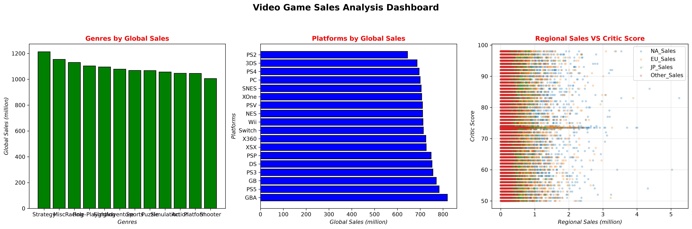

# 🎮 Video Game Sales Analysis

An exploratory data analysis project focused on video game sales across different genres, gaming platforms, and regions. This project uses Python to clean, explore, analyze, and visualize video game sales data to discover meaningful patterns and insights.

## 📌 Project Overview

The main goal of this project is to perform Exploratory Data Analysis (EDA) on a video game sales dataset, identify data quality issues, investigate sales trends, and understand the relationship between critic scores and sales performance.

This is an independent learning project developed through self-study.

## 🎯 Project Objectives

- Understand and inspect the dataset.
- Clean missing values and remove duplicate records.
- Analyze global sales by genre and platform.
- Explore sales distributions across different regions.
- Investigate the relationship between critic scores and global sales.
- Create visualizations to communicate the findings.

## 🛠️ Tools & Technologies

- **Python** – Programming language.
- **Pandas** – Data manipulation and analysis.
- **Matplotlib** – Data visualization.

## 📂 Dataset Description

The dataset contains 10,500 records and 11 columns, including:

| Column | Description |
|---|---|
| Name | Video game title |
| Platform | Gaming platform |
| Year | Release year |
| Genre | Game genre |
| Publisher | Game publisher |
| NA_Sales | North American sales |
| EU_Sales | European sales |
| JP_Sales | Japanese sales |
| Other_Sales | Sales in other regions |
| Global_Sales | Total global sales |
| Critic_Score | Critics' review score |

## 🧹 Data Cleaning

Several cleaning and validation steps were performed:

- Inspected the dataset using `head()`, `info()`, and `dtypes`.
- Checked for duplicate records using `drop_duplicates()`.
- Identified missing values in the `Critic_Score` column.
- Handled missing critic scores using median imputation (**73.5**).
- Compared global sales with the sum of regional sales.
- Addressed small numerical discrepancies through rounding to two decimal places.

Approximately **25.68%** of the critic score values were missing.

No exact duplicate rows were found during the full-row duplicate check.

## 📊 Exploratory Data Analysis

### 1. Sales by Genre

Strategy was the highest-selling genre in the dataset, with approximately **1,213.35 million** in global sales.

Other high-performing genres included Misc, Racing, and Role-Playing.

### 2. Sales by Platform

GBA recorded the highest global sales among the analyzed platforms, with approximately **819.35 million**.

PS2 recorded the lowest total, with approximately **644.32 million**.

### 3. Critic Scores and Global Sales

The Pearson correlation coefficient between `Critic_Score` and `Global_Sales` was approximately **0.0151**.

This indicates a very weak linear relationship between critic scores and global sales in the dataset.

## 📈 Data Visualization

The project includes three main visualizations:

1. Bar Chart – Global Sales by Genre.
2. Horizontal Bar Chart – Global Sales by Platform.
3. Scatter Plot – Regional Sales vs. Critic Scores.

### Video Game Sales Dashboard

## 💡 Key Findings

- Strategy recorded the highest global sales among genres.
- GBA was the leading platform by global sales.
- Critic scores showed a very weak linear correlation with global sales.
- Sales patterns vary across different regions and platforms.
- Further analysis and additional data would be needed to investigate other factors influencing sales.

## ⚠️ Data Quality Note

Some year and platform combinations in the dataset appear historically inconsistent. Therefore, the findings should be interpreted as results from the supplied dataset rather than as a verified historical record of the video game industry.

## 📝 Conclusion

This project provided practical experience in data cleaning, exploratory data analysis, and data visualization using Python, Pandas, and Matplotlib.

It represents my first independent data analysis project and an important step in developing my analytical and technical skills.

**More projects and improvements will follow as I continue learning Data Analysis.**

---

*Created as an individual learning project.*